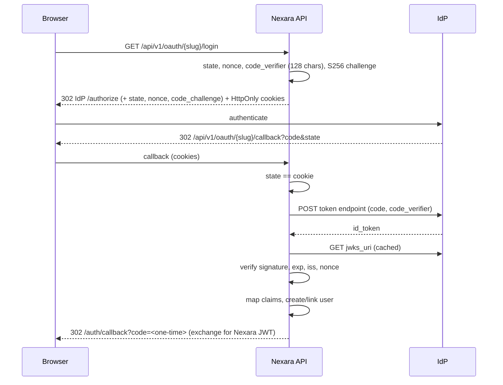

# SSO with generic OpenID Connect

Nexara supports any OIDC-compliant IdP (Keycloak, Authentik, Google, Entra ID, Okta)
using the authorization code flow with PKCE.

## Flow



## Security properties

- Discovery URL, issuer and endpoints must be `https` and must not resolve to
  localhost or private IPs. Discovery documents are cached for 24 h.
- PKCE (S256) is always used; the verifier is 128 random characters.
- `state` is checked against an HttpOnly cookie; `nonce` against the ID token.
- ID tokens must be signed (RS256/ES256, keys from `jwks_uri`), unexpired
  (`exp` is mandatory) and issued by the configured issuer. Unsigned tokens are rejected.
- Client secrets are Fernet-encrypted at rest and never returned by the API.

## Admin API

| Method | Path | Purpose |
|---|---|---|
| POST | `/api/v1/admin/oauth/providers/oidc` | Register from `discovery_url`, `client_id`, `client_secret` |
| GET | `/api/v1/admin/oauth/providers` | List (secrets omitted) |
| PUT | `/api/v1/admin/oauth/providers/{id}` | Update |
| DELETE | `/api/v1/admin/oauth/providers/{id}` | Remove |
| POST | `/api/v1/admin/oauth/providers/{id}/test` | Re-run discovery and a sandbox token request |

Redirect URI to register at the IdP: `<origin>/api/v1/oauth/<slug>/callback`.

## Claim mapping

`claim_mapping` maps Nexara fields to provider claim names (dotted paths allow
nested claims). Unspecified fields use the defaults.

| Nexara field | Default claim | Example override |
|---|---|---|
| `sub` | `sub` | |
| `email` | `email` | `"mail"` |
| `name` | `name` | `"preferred_username"` |
| `picture` | `picture` | |
| `groups` | `groups` | `"realm_access.roles"` |

Groups feed the existing `group_mappings` to role mapping. Providers with an empty
`claim_mapping` fall back to the legacy `*_claim` columns.

## Provider setup

### Keycloak
1. Create an OpenID Connect client, access type confidential, standard flow on.
2. Valid redirect URI: the callback above.
3. Add a "Group Membership" mapper (claim `groups`, full path off).
4. Discovery URL: `https://<host>/realms/<realm>/.well-known/openid-configuration`.

### Authentik
1. Create an OAuth2/OpenID provider, client type confidential, redirect URI as above.
2. Scopes: openid, profile, email (groups are in the `groups` claim by default).
3. Discovery URL: `https://<host>/application/o/<app-slug>/.well-known/openid-configuration`.

### Microsoft Entra ID
1. App registration, platform Web, redirect URI as above; create a client secret.
2. Token configuration: add the `groups` optional claim (or use app roles with
   `"claim_mapping": {"groups": "roles"}`).
3. Discovery URL: `https://login.microsoftonline.com/<tenant>/v2.0/.well-known/openid-configuration`.

## Example

```json
POST /api/v1/admin/oauth/providers/oidc
{
  "slug": "keycloak",
  "display_name": "Keycloak",
  "discovery_url": "https://kc.example.com/realms/home/.well-known/openid-configuration",
  "client_id": "nexara",
  "client_secret": "...",
  "claim_mapping": {"groups": "realm_access.roles"}
}
```

## Group to subgroup and role mapping (optional)

Add a `group_mapping` section to `claim_mapping` to place users in subgroups and
assign community roles on every SSO login. Without it, nothing extra happens.

```json
PUT /api/v1/admin/oauth/providers/{id}
{
  "claim_mapping": {
    "groups": "groups",
    "group_mapping": {
      "eng":    {"subgroup_id": "<subgroup-uuid>", "role": "member"},
      "design": {"subgroup_id": "<subgroup-uuid>", "role": "moderator"},
      "admin":  {"subgroup_id": null, "role": "admin"}
    }
  }
}
```

- `subgroup_id` set: the user is added to that subgroup with `role`
  (subgroup role). Existing memberships are never duplicated or changed.
- `subgroup_id` null: `role` is a community role. If several groups match, the
  highest wins (`admin` > `member` > `viewer`).
- Groups with no mapping, or whose subgroup no longer exists, are skipped and a
  warning is logged; login never fails because of them.
- Memberships are only added, never removed, when a group disappears from the token.
- Rules are validated on create/update (422 on error): with `subgroup_id`, `role`
  must be `owner`, `moderator` or `member`; without it, `viewer`, `member` or
  `admin`. Other `claim_mapping` keys must be strings.

Preview the mapping (no writes). Optional `groups` simulates a token:

```
GET /api/v1/admin/oauth/providers/{id}/group-mapping-preview?groups=eng&groups=admin
```

### Keycloak
Add the "Group Membership" mapper (claim `groups`, full path off). Group names
in `group_mapping` must match exactly, e.g. `eng`. For realm roles use
`"groups": "realm_access.roles"`.

### Authentik
The `groups` scope mapping returns group names in `groups`; use those names as
`group_mapping` keys.
